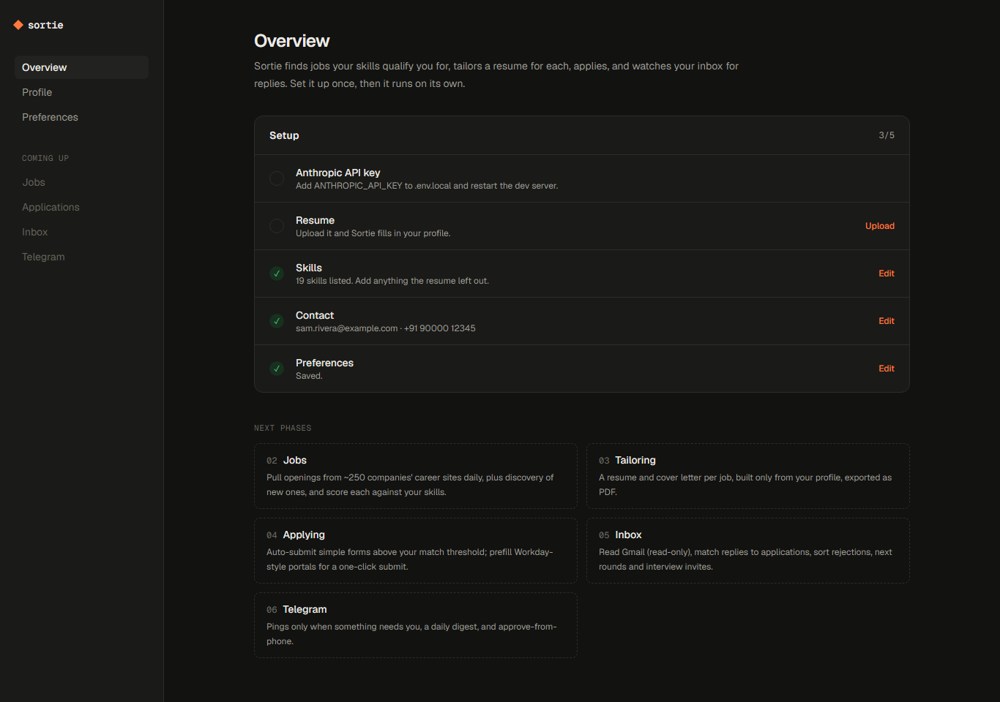
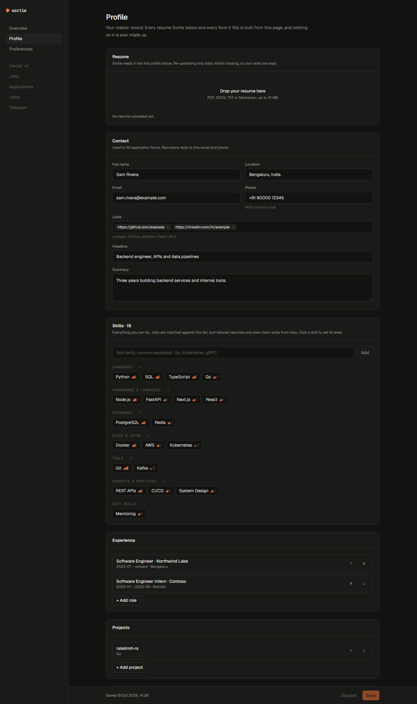
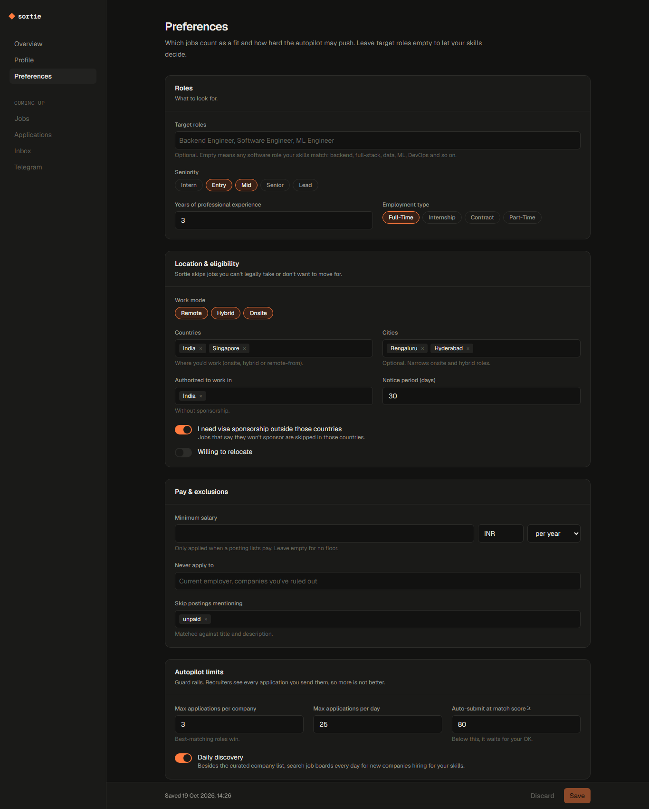
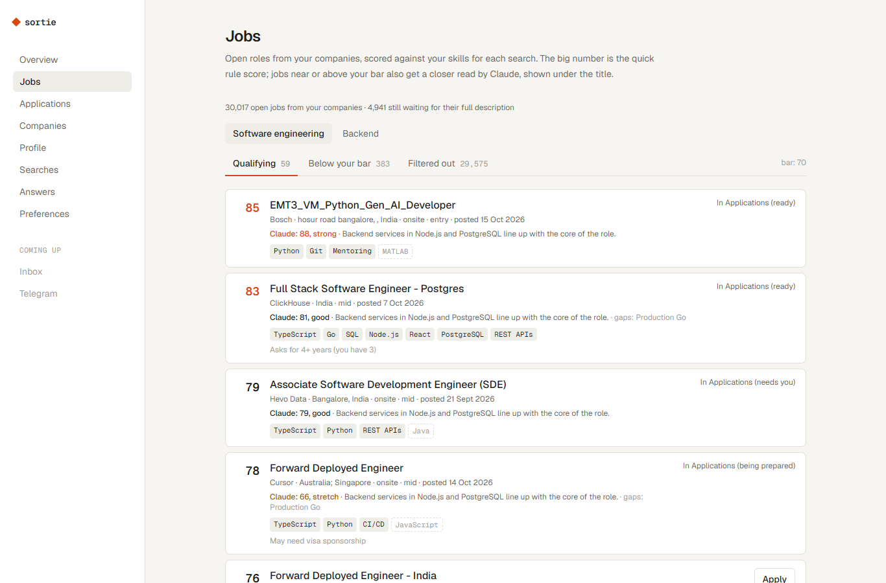
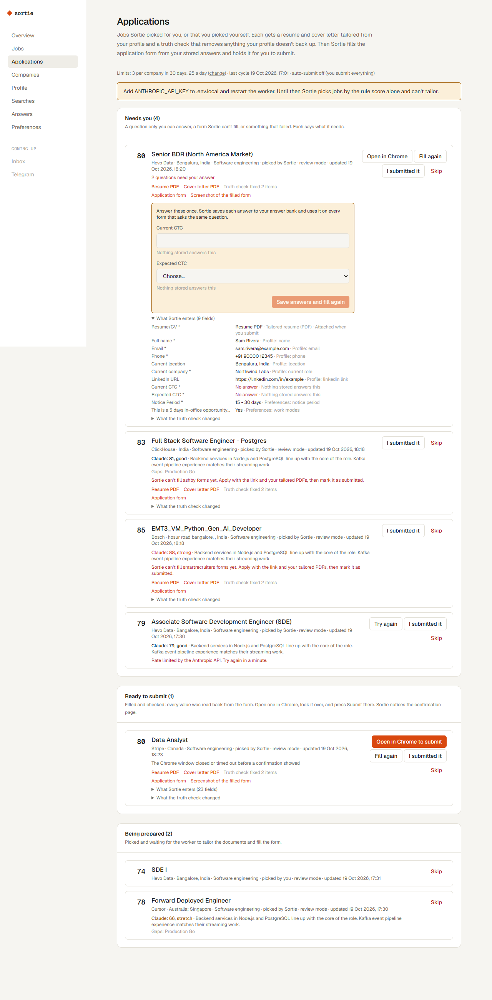
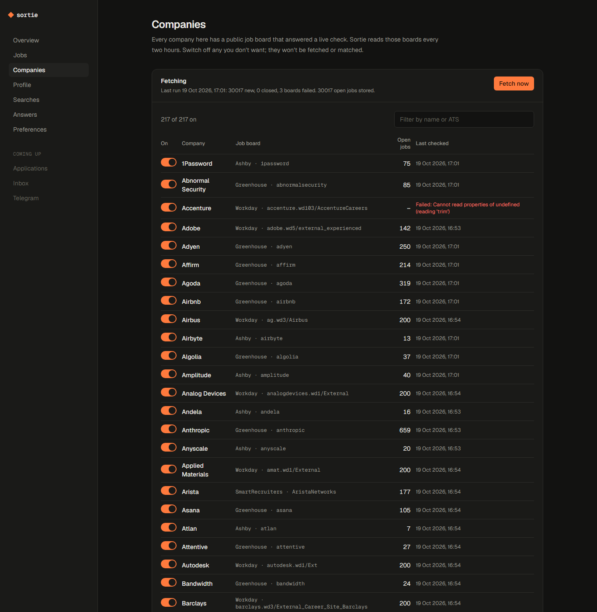

# Sortie

A personal job-application copilot. You give it your resume and every skill you have. It finds software
jobs at good companies that you're actually eligible for, applies with your resume (tailored only where it
would otherwise undersell you), and
watches your Gmail so you only hear about the replies that need you.

It runs on your own machine, with your own Anthropic API key. Your resume and profile never leave your
computer except in the requests Sortie sends to Claude.

> **Status: phases 1–3 of 6 done.** Profile, resume reading, searches, answers and preferences; live job
> sourcing from 217 verified company boards with filtering and match scores; and Claude reviews,
> selection under your limits, and your resume per job: as uploaded, or tailored and fact-checked where
> the review says it undersells you.
> Applying, Gmail and Telegram are next (see [Roadmap](#roadmap)). The full engineering record (requirements, architecture, data model,
> every decision and tradeoff, plan, risks) is in **[docs/](docs/README.md)**.



| Profile | Preferences |
| --- | --- |
|  |  |
| **Jobs** | **Applications** |
|  |  |
| **Companies** | |
|  | |

_Screenshots use a made-up demo profile._

## What works now

- **Resume reading.** Drop in a PDF, DOCX, TXT or Markdown resume. Claude reads it into a structured
  profile: contact details, skills, roles, projects, education and certifications. It copies facts and
  doesn't invent them.
- **Skills editor.** Every skill gets a category, a level (learning, working, strong, expert) and
  optional years. You can paste a comma-separated list to add many at once, and common skills are
  categorised automatically. Jobs will be matched against this list.
- **Safe re-uploads.** Uploading a newer resume only fills gaps and adds new entries. Anything you've
  already edited by hand is kept.
- **Searches.** Run several hunts at once (say "Backend" and "ML engineer"), each with its own titles
  (or none, to let your skills decide), seniority, employment type, excluded keywords, selectivity and
  mode: *review first* or *auto-apply*.
- **Screening answers.** Expected and current salary, a free-text fallback, "how did you hear",
  US self-identification (defaults to decline), and an answer bank for anything else forms ask, with
  common questions one click away. Questions you answer on the Applications page are added to it, so
  each one is asked only once.
- **Preferences.** Work mode, countries and cities, work authorization and sponsorship, notice period,
  a salary floor, companies to exclude, and the autopilot limits: a cap per company and a daily cap.
- **Jobs from 217 companies.** Sortie reads the public job boards of companies on Greenhouse, Lever,
  Ashby, SmartRecruiters and Workday: Stripe, Databricks, OpenAI, Cloudflare, Palantir, Accenture,
  PwC, Intel, Cisco, Salesforce, Adobe, Visa, Mastercard, Citi, Freshworks, Razorpay, Meesho, CRED and
  more. Every board on the list answered a live check before it was added. Big names on portals with
  no public feed (Deloitte, EY, KPMG, SanDisk, Google, Microsoft, Infosys and others) are listed with a
  careers link instead of being scraped.
- **Filtering with reasons.** Each job is checked against each search: software role or your titles,
  seniority, job type, work mode, your countries and cities, visa sponsorship, salary floor, years
  asked for, excluded companies and keywords. Rejected jobs say why in plain words.
- **Match scores.** Jobs that pass get a 0–100 score from your skills (weighted by level), the title,
  years asked for and freshness, with the skills you have and the ones the posting wants that you
  don't list.
- **Claude's second opinion.** Jobs near or above a search's bar get a review from Claude (Sonnet 5.5):
  a score, a verdict, the reasons, the must-haves you're missing, and any dealbreaker such as a
  citizenship requirement. Reviews are cached, so a job is only reviewed again when it or your profile
  changes.
- **Picking within your limits.** Each cycle picks the best jobs that clear your bar, best first, at
  most N per company in 30 days and M a day. You can also press **Apply** on any job yourself.
- **Your resume, tailored only when it helps.** Each pick goes out with the resume you uploaded. The
  review also reads that resume as written and says when it would likely be passed over for this job
  even though your experience fits (relevant work buried, worded differently, crowded out). Only then
  does Claude (Opus 5.5) reword and reorder your profile for that job. A cover letter is written only
  when a form requires one. Anything Sortie writes passes a truth check that removes
  anything your profile doesn't back up: first with rules (no new numbers, skills or technologies, and
  a bullet may only use facts from its own role), then with a second Claude pass. Employers, titles
  and dates always come straight from your profile. The result is a clean one-column PDF that
  applicant tracking systems can read, and the **Applications** page shows exactly what the check
  changed.
- **Filled application forms.** For Greenhouse and Lever jobs, Sortie reads the application form, works
  out every answer from what you've stored, fills it in Chrome and reads each value back. Consent
  questions (interview recording, privacy, opt-ins) are always yours to answer. When a question has no
  stored answer, Claude may answer it only by quoting your data, and code checks the quote. Anything
  else comes to you once and is remembered. Each application shows exactly what will be entered,
  where each value came from, and a screenshot.
- **You press Submit.** **Open in Chrome to submit** opens the filled form, files included, in a
  Chrome window. You look it over and submit it, and Sortie sees the confirmation page and marks it
  submitted. Sortie only submits on its own for searches in auto mode, with `SORTIE_AUTO_SUBMIT=on`,
  when no answer came from Claude, every value read back, and no CAPTCHA is showing. CAPTCHAs are never
  solved or bypassed. For other boards, it gives you the link and the PDFs and you mark the job
  applied.
- **Background worker.** `npm run worker` runs a cycle every ~2 hours: fetch, match, review, pick,
  tailor, fill forms. **Companies** shows every board with its last result and an on/off switch. A
  board that rate-limits Sortie is rested for 12 hours instead of being hammered.
- **Setup checklist** on the overview page.

## Design rules

These shape every phase, not just the current one:

1. **Never invent anything.** Tailored resumes and form answers can reorder, reword and emphasise
   what's in your profile, but they can't add skills or experience you don't have.
2. **Respect the sites.** No scraping of LinkedIn or Glassdoor, since both ban accounts for it. Jobs
   come from companies' own career sites (Greenhouse, Lever, Ashby, SmartRecruiters and Workday
   feeds) and a jobs API for discovering new companies.
3. **Quality over volume.** There's a cap per company (3 by default), because recruiters see every
   application you send them. There's also a daily cap.
4. **Hybrid autopilot.** Sortie does the work and you make the call. Forms are filled and checked
   for you; you press Submit unless you've switched auto-submit on, and even then only forms with
   nothing for a person to decide go out on their own. Portals that need accounts, and any CAPTCHA,
   are always yours.
5. **Local and private.** Everything lives in `data/` (SQLite plus your uploads), which is gitignored.
   The server only listens on `127.0.0.1`.

## Architecture

```
 browser ──▶ Next.js app (127.0.0.1)
              pages: Overview · Jobs · Applications · Companies · Profile · Searches · Answers · Preferences
              API:   /api/resume /api/profile /api/searches /api/answers /api/preferences
                     /api/companies/[id] /api/fetch /api/applications/**
                       │
                       ▼
              src/lib  (shared, framework-free)
                llm.ts ──▶ Claude            store.ts / jobs.ts ──▶ node:sqlite  data/sortie.db
                sources/* ──▶ Greenhouse · Lever · Ashby · SmartRecruiters · Workday (public JSON)
                match.ts + geo.ts   filters and scores          pipeline.ts  fetch → store → match
                autopilot.ts  review → pick → tailor → truth check → PDF → apply/ (fill, check, hold)
                       ▲
              worker (npm run worker): every ~2 h, on "Fetch now", and "Open in Chrome" ──▶ Chrome
```

| Path | What it does |
| --- | --- |
| `src/lib/schema.ts` | Zod schemas for the profile, the parsed resume, searches, answers and preferences. They're the single source of truth for types and validation. |
| `src/lib/llm.ts` | Anthropic client and resume parsing (structured outputs, server-side refusal fallback). |
| `src/lib/merge.ts` | Folds a parsed resume into the profile without overwriting your edits. |
| `src/lib/db.ts` | Opens `data/sortie.db` lazily with Node's built-in SQLite and runs versioned migrations. |
| `src/lib/store.ts` | Keyed settings documents (profile, preferences, searches, answers) and uploaded documents. |
| `src/lib/setting-route.ts` | One GET/PUT handler pattern shared by the settings APIs. |
| `src/lib/skills.ts` | Category guesses for hand-typed skills, plus the labels. |
| `src/lib/sources/*` | One adapter per ATS, turning public job feeds into one job shape; polite HTTP (User-Agent, per-host gap, retries). |
| `src/lib/registry/companies.json` | The verified company list, generated by `npm run registry:verify`. |
| `src/lib/jobs.ts` | Companies, jobs, matches and the worker's task queue. |
| `src/lib/match.ts`, `src/lib/geo.ts` | Hard filters and the deterministic score; location text to countries. |
| `src/lib/pipeline.ts` | One cycle: registry, fetch boards, fill descriptions, match, then prepare. |
| `src/lib/autopilot.ts` | Prepare: Claude reviews, selection under the caps, your resume or a tailored one (D-058). |
| `src/lib/review.ts`, `src/lib/select.ts` | Claude's job review (cached by input hash); the pure selection rules. |
| `src/lib/tailor.ts`, `src/lib/truth.ts` | Tailoring and the two-pass truth check. |
| `src/lib/resume-html.ts`, `src/lib/pdf.ts` | The ATS-friendly resume and cover letter, printed to PDF by your installed Chrome. |
| `src/lib/apply/*` | The form step: read Greenhouse/Lever forms, plan answers (rules → answer bank → quote-checked Claude), fill and read back, the auto-submit gate, Open in Chrome. |
| `src/lib/applications.ts` | Reviews, applications and their step history. |
| `src/worker/index.ts` | The background worker. |
| `src/app/api/*` | Route handlers for resume upload, settings, company switches, Fetch now, Apply, application actions, answers to form questions, and PDF and screenshot downloads. |
| `src/components/*` | The editors (profile, skills, entry lists, preferences) and small UI primitives. |

## Setup

Requirements: **Node.js 24+** (for built-in `node:sqlite`), **Google Chrome** (for PDFs and forms), and an
[Anthropic API key](https://console.anthropic.com/) **or** a [Gemini API key](https://aistudio.google.com/apikey)
on a project with billing enabled (the free tier may use your resume for training).

```bash
git clone https://github.com/alex-in-CS/sortie.git
cd sortie
npm install
cp .env.example .env.local   # then put your key in ANTHROPIC_API_KEY
npm run dev                  # http://127.0.0.1:3000
```

Then upload your resume on **Profile**, fill in any skills it missed, and set **Preferences**.
In a second terminal start the worker, which fetches jobs now and every ~2 hours:

```bash
npm run worker               # or: npm run fetch  (one cycle, then exit)
```

Open **Jobs** to see matches, and **Applications** for the jobs Sortie picked and their tailored PDFs.

| Variable | Default | Purpose |
| --- | --- | --- |
| `ANTHROPIC_API_KEY` | (required) | Reading resumes, reviewing jobs, tailoring and the truth check. |
| `SORTIE_MODEL` | `claude-opus-5-5` | Resume reading, tailoring and the truth check. |
| `SORTIE_BULK_MODEL` | `claude-sonnet-5-5` | Answers to form questions. |
| `SORTIE_REVIEW_MODEL` | `claude-haiku-5-5` | Job reviews, including whether your resume needs tailoring for a job. |
| `SORTIE_REVIEWS_PER_CYCLE` / `SORTIE_TAILOR_PER_CYCLE` | `40` / `10` | Spending limits per cycle. |
| `SORTIE_CHROME_PATH` | Chrome | Another Chromium browser for PDFs, if Chrome isn't installed. |
| `SORTIE_DATA_DIR` | `./data` | Where the database and uploads are stored. |
| `SORTIE_FETCH_HOURS` | `2` | Hours between fetch cycles. |

### Scripts

| Command | What it does |
| --- | --- |
| `npm run dev` | Dev server on 127.0.0.1:3000 |
| `npm run build` / `npm start` | Production build and server |
| `npm run worker` | Background worker (a cycle every ~2 h, plus queued tasks) |
| `npm run fetch` | One full cycle now: fetch, match, review, pick, tailor |
| `npm run registry:verify` | Re-check every company board live and rewrite the registry |
| `npm test` | Unit tests (Vitest) |
| `npm run typecheck` | `tsc --noEmit` |
| `npm run lint` | ESLint |

## Tech stack

Next.js 16 (App Router, Cache Components) · React 19 · TypeScript · Tailwind CSS 4 · Node 24
`node:sqlite` · Zod 4 · Anthropic TypeScript SDK (structured outputs) · mammoth (DOCX) · playwright-core with the installed Chrome (PDFs and form filling) · tsx (worker) · Vitest.

## Roadmap

| # | Phase | Status |
| --- | --- | --- |
| 1 | Profile, resume reading, skills, searches, screening answers, preferences | **Done** |
| 2 | Jobs: 217 verified company boards, checks every 2 hours, deduplication, filters with reasons, and a match score against your skills | **Done** (discovery API pending a key) |
| 3 | Tailoring: Claude reviews the best matches; picks within your caps; your resume per job, tailored (two-pass truth check, PDF) only where it undersells you; cover letters only when a form requires one | **Done** |
| 4 | Applying: Greenhouse and Lever forms filled and checked from your data, held for you to submit in Chrome (or auto-submitted through a strict gate), answers learned, other boards handed off with a link | **Done** (stages after Submitted come with phase 5) |
| 5 | Inbox: read-only Gmail that matches replies to applications and moves them on the board | Next |
| 6 | Telegram: alerts only when something needs you, a daily recap, and approving from your phone | Planned |
| 7 | Interview prep: a prep pack and mock interview when an invite arrives | Stretch |

The build plan is in [docs/plan.md](docs/plan.md).

## License

[MIT](LICENSE)
